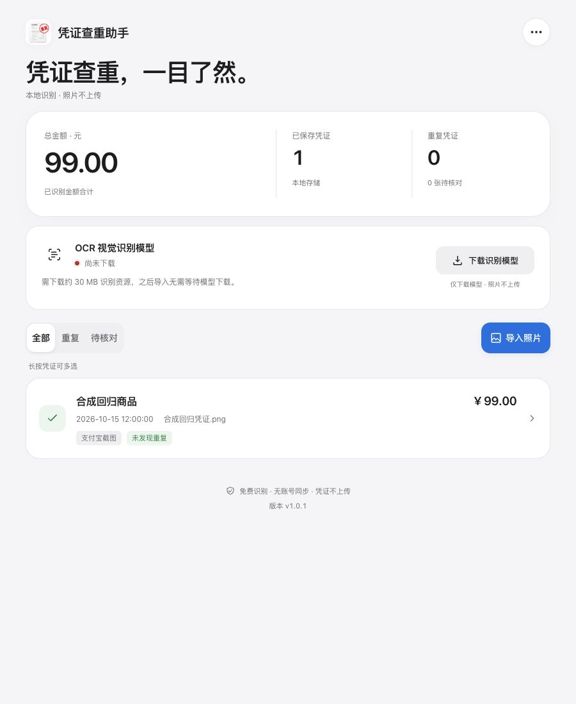
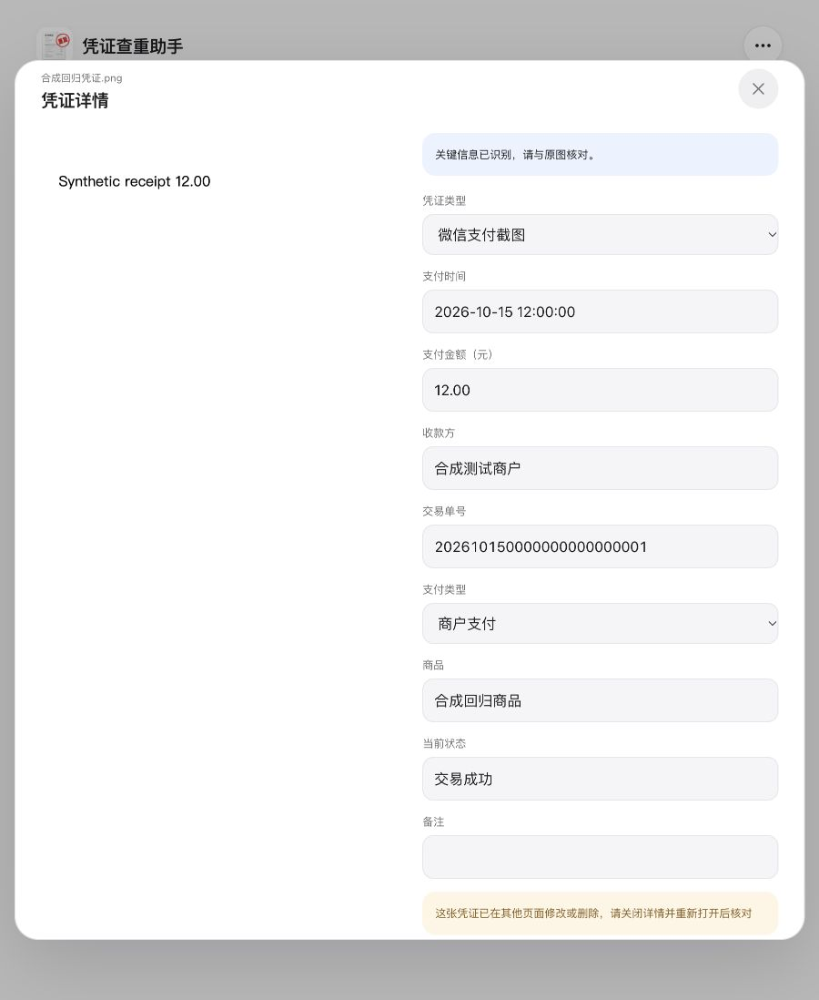

# 凭证查重助手 v1.0.1

2026-10-15，完成代码复查中发现的四项修复，并统一网站名称、增加主页底部版本号。

- 详情布局切换保留原编辑记录快照及修订号。其他页面修改或删除后，旧草稿不能通过切换下拉控件获得新修订号。
- 恢复前备份同时捕获记录快照；完成解压和校验后，在同一数据库写入事务中比对当前记录。期间任何新增、修改、删除都会中止恢复，保留当前记录和照片，并提示重新备份后重试。最初为空的列表同样检查。
- 支付宝单独及混合导出均保留商品说明；电子凭证原五列保持不变。
- 备份与恢复共享 500 MB、5000 条记录、8 MB 记录 JSON 和 100 MB 单张照片限制。备份先验证字段结构及照片摘要，生成后检查 ZIP 大小；不再为超限或损坏数据显示成功。没有自动删减记录或照片。
- 网站页头、HTML 标题、主屏幕名称、Excel/ZIP 下载名称更新为“凭证查重助手”。主页底部显示“版本 v1.0.1”，版本由构建脚本从 package.json 读取。

验证结果：

- 构建成功。
- 119 项自动测试全部通过，新增回归涵盖支付宝商品列、混合导出列对齐、恢复前并发新增/编辑/删除、空快照保护、无变更正常恢复、超限 JSON、无效字段、记录数超限与照片损坏。
- 真实本地浏览器：打开 12 元合成凭证详情；第二页面改为 99 元并广播；旧详情切换至微信截图再保存，显示“这张凭证已在其他页面修改或删除，请关闭详情并重新打开后核对”。关闭详情后主页仍显示 99 元。
- 真实浏览器确认名称和底部版本号显示，检查时没有 warning/error 日志。截图为合成数据，不含私人凭证。

本轮没有重新验收真实照片 OCR、iPhone Safari 真机及断网更新。浏览器的窄屏覆盖设置未实际生效，因此不将其计为移动端验收。
