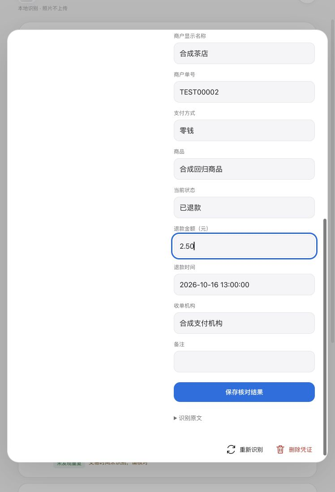

# v1.0.3 复查与修复

2026-10-16，本轮检查识别解析、字段核对、页面返回同步与离线更新。README 保持简洁，技术验证留在此处。

## 本轮修复

- **通用商户字段串行。** 商户名称只有标签、没有值时，原逻辑可能把紧随其后的 `实付金额12.00`、日期或订单行拼入商户。现在紧凑的数字、货币及符号标签也会截断取值，缺失的商户继续提示核对。
- **支付宝优惠文字污染。** 收款方全称和商品说明的连续行取值，现在遇到优惠、焕新折扣、银行立减等标签即停止。优惠仍单独保留，不替代支付金额。
- **通用补扫跨单号合并。** 两轮已有完整有效单号且不同，即使原金额或日期缺失，也拒绝混入另一单号的字段。原来此保护还要求金额和精确日期齐全。
- **通用凭证漏判重复。** 相同完整订单、精确时间及商户、来源下，`12` 与 `12.00`、商户或机构名称周围的空白不再阻断查重。金额、商户、机构或时间实质不同时继续分开；日期不完整和金额超范围时不把通用单号作为可靠判重依据。
- **缺失状态无法核对。** 微信及支付宝截图的支付状态即使漏识别，也始终显示可编辑字段。微信截图有退款信号时，同时显示退款金额与退款时间，便于补齐。
- **补充金额输入不一致。** 退款、原价金额也规范全角、千分位和货币符号，手机端使用 decimal 输入提示；不合法的小数保留原输入，避免无依据截断。
- **切回页面数据过期。** 返回页面及切回前台时重新读取记录；处理中延后刷新，保留打开中的详情草稿与原修订号。较早发起但较晚完成的读取不能覆盖新快照。
- **页面更新受旧 HTTP 缓存影响。** Service Worker 安装外壳时绕过旧 HTTP 缓存，在线读取 HTML/JS/CSS 时要求重新验证；离线仍回退已保存外壳。OCR 模型沿用已校验资源，不强制重复下载。
- 为页面名称与详情弹窗补充语义标题，界面布局保持原样。

## 验证

- 修改前 119 项测试通过；新增边界用例确认原有错误，再修复。最终构建成功，131 项测试全部通过，结果在 `validation-v1.0.3/tests.txt`。
- 使用真实浏览器、真实 PaddleOCR Worker 导入三种合成图片：支付宝优惠邻接、通用凭证缺商户、微信截图缺状态。通用凭证的金额和日期可提取，商户保持缺失提示；微信状态可补填保存并解除对应提示。
- 支付宝合成图片中，模型仍将“收款方全称”标签读成“收款方至称”，因此采用顶部商户显示名回退。没有针对单个样本做全局错字替换，不能宣称这一轮提高了模型本身的识别准确率。
- 第一版合成图片因测试字体缺字出现方框，已更换完整中文字体重跑；缺字图片的结果不作为成功识别证据。
- 浏览器模拟断网后重新加载页面，再导入同一张合成支付宝图片：识别成功、金额 12.00、重复记录 2 张。验证后恢复测试浏览器正常网络。这是浏览器网络模拟，不是 iPhone 真机断网测试。
- 用第二页面无广播修改本轮合成记录，再模拟 pageshow 返回事件：列表读到 24.60，打开中的旧详情仍为 23.60；旧草稿保存被修订号保护拒绝。
- 退款金额输入 `￥２．５０`，保存重开为 `2.50`；补填退款时间后，实际下载的 Excel XML 中退款金额为数值、退款时间为日期数值，商品说明保留。
- 从代码及浏览器检查：表单字体 16px，退款金额带 `inputmode="decimal"`，已有触摸、hover 能力查询、安全区域与缩放设置保持。没有 iPhone 真机键盘和手势验收。

## 仍需实际样本或产品取舍

本轮没有重新验证历史私人照片，不调整模型或以合成样本声称真实准确率提升。后续最有价值的是按真实问题图片统计金额、单号、日期和收款方的错误类型；字段位置、原文和置信度可作为下一步补扫依据。

金额合计仍包含重复凭证，退款仍单独列出、不自动扣减；删除记录仍按既定设计保留浏览器照片副本。若需要去重后的净额或主动清理照片，应作为明确的功能变更处理。
