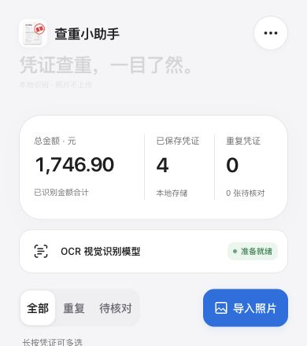

# 最终检查与交付验收（2026-10-15）

## 已确认并修复的边界问题

| Before | After | Why |
| --- | --- | --- |
| 实付标签存在但值为空时可能采用合计 | 空值也保留高优先级标签证据，先重试，不以合计充数 | 避免错录实付金额 |
| 通用凭证的待支付等状态没有提示 | 对已识别的未支付、失败、关闭、撤销、退款及明确正号收入提示核对 | 避免把异常状态当作普通支出 |
| 只有日期的通用凭证补扫到流水号后可能丢弃该值 | 分开处理单号录入格式与判重证据强度 | 不丢有效字段，也不放宽自动判重 |
| 通用判重只检验日期形状 | 同时校验真实日历日期、有效金额和精确时间 | 防止无效证据参与单号判重 |
| 只有日期的通用凭证在 Excel 排到末尾 | 用真实日期排序，单元格仍保留原有文本精度 | 排序正确且不虚构时间 |
| 联系信息中的微信号可能误触电子凭证规则 | 要求额外的交易单号和金额标签证据 | 避免陌生凭证套错类型 |
| 手机总金额小数末位可能单独换行 | 按容器宽度和金额字符数调整字号，金额保持一行 | 避免金额读错，保留三栏布局 |
| 残留未使用的 Tesseract 依赖 | 删除依赖及构建允许项，锁文件减少相应条目 | 保持维护与安装简洁 |

常规截图的 OCR 模型、分辨率与单轮路径未降低，不以牺牲清晰度换取速度。补扫次数仍有上限。

## 验证结果

- 完整构建成功；99 项自动测试通过，涵盖识别、通用提取、重试次数、金额日期校验、查重、存储失败恢复、ZIP 恢复保护、模型缓存、离线异常、交互与本地预览服务。
- 使用此前实际 OCR 保存的 42 张微信/支付宝截图文字与坐标，再逐项解析对比金额、交易时间、收款方、交易/订单号、商品说明，未发现变化。本轮未重跑这 42 张图片的模型推理；此前的完整模型复测记录见其他验收文档。
- 交付构建在浏览器实际导入四种虚构银行回单/小票/旅行订单/服务凭据 PNG，全部保存成功，金额合计 1746.90 元，0 张待核对；详情保留商品与机构。
- 实际从网页下载 Excel 与 ZIP 备份，检查归档完整性、Excel 合计/商品/机构内容，以及备份中 4 条记录和 4 张照片，均正常。
- 金额字号调整后，在 390px 宽度实测 1,746.90 与 12,346,145.30 均保持一行，内容宽度未超过容器；金额修改测试只使用虚构凭证，完成后已还原。
- 320 / 390 / 1280px 宽度：页面宽度与视口一致，无横向溢出；导入按钮高度 48px，筛选按钮高度 44px。
- 深色模式背景为 rgb(13,13,15)，减少动态效果开启后状态动画为 none。手机测试为浏览器尺寸模拟，不代表手机硬件性能测试。
- 保留识别弹窗简化、商品优先显示、长文本换行、深色模式、安全区域和既定按钮焦点外观；本轮没有为视觉变化引入新框架或重新设计布局。

## 交付检查

完整包包含源码、锁文件、测试、构建产物、模型、WASM、第三方许可、开发/部署说明和本地预览工具。真实凭证、私人识别原文、浏览器数据库、本机迁移配置、Git 历史和 node_modules 均不进入包内。

压缩包生成后执行 CRC 与逐文件 SHA-256 校验，并在新解压目录按锁文件安装、构建和运行测试，另行确认打包内容可用。发布时确认线上脚本、样式和 Service Worker 与交付构建一致。

不能据此保证任意图像均能识别或软件没有任何未发现缺陷；保留原图、备份和字段核对入口。

## 最终页面截图

